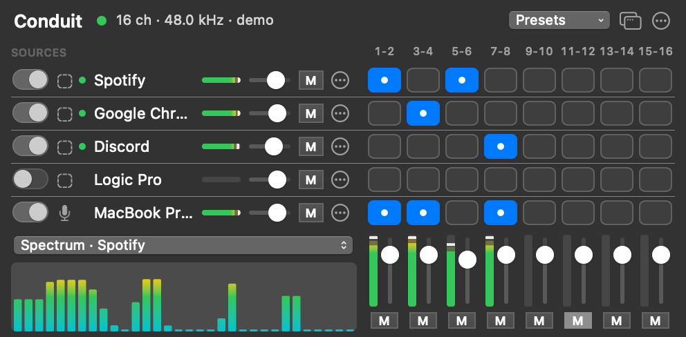
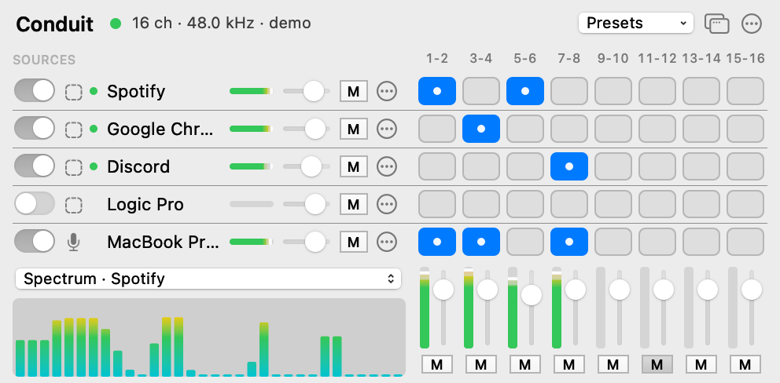

<h1 align="center">Conduit</h1>

<p align="center">
  <b>A free, open-source virtual audio router and mixer for macOS.</b><br>
  Send any app's audio, or your microphone, into a 16-channel virtual device, mix it from the menu bar,<br>
  and pick that device as the input in OBS, Zoom, Discord or your DAW.
</p>

<p align="center">
  <a href="https://github.com/ShivamHimatsingka/conduit/releases/latest"><b>⬇ Download</b></a> ·
  <a href="#quick-start">Quick start</a> ·
  <a href="#how-it-works">How it works</a> ·
  <a href="docs/ARCHITECTURE.md">Design &amp; measurements</a> ·
  <a href="#troubleshooting">Troubleshooting</a>
</p>

<p align="center">
  <a href="https://github.com/ShivamHimatsingka/conduit/actions/workflows/ci.yml"></a>
  
  
  
  
</p>

<p align="center">
  
  <br>
  <sub>The mixer in dark and light mode (demo data).</sub>
</p>

> **Alpha software.** Conduit works and is tested end to end, but it is new, it has been run on one Mac so far, and the download is not yet notarized by Apple (see [Status](#status-and-known-limitations)). Please [report anything odd](https://github.com/ShivamHimatsingka/conduit/issues).

---

## What is it?

macOS has no built-in way to send one app's sound into another app. Conduit adds that:

* a **virtual audio device**, "Conduit 16ch", that any app can record from or play to, and
* a **menu-bar mixer** that captures individual apps and microphones and routes them onto the device's channels.

Typical uses: stream Spotify and your mic into OBS on separate channels, send a game's audio but not your notifications to a Zoom call, feed a browser tab into a DAW, or record an app's output without a screen recorder.

## Quick start

1. **[Download the latest release](https://github.com/ShivamHimatsingka/conduit/releases/latest)**, unzip it and drag **Conduit.app** into `/Applications`.
2. **Open it.** The first launch is blocked by macOS because the build is not notarized yet: open **System Settings → Privacy & Security** and click **Open Anyway** (or run `xattr -dr com.apple.quarantine /Applications/Conduit.app`).
3. Conduit offers to **install its audio driver**. Click *Install Driver*, enter your administrator password, and wait a moment while Core Audio restarts. *(The driver is inside the app: there is nothing else to download.)*
4. Click the **slider icon in the menu bar**. Turn on a source (an app that is playing sound, or a microphone) and click a cell in the grid to send it to a bus. **Bus 1-2** is the stereo pair most apps read.
5. In OBS, Zoom, Discord or your DAW, choose **Conduit 16ch** as the **input** device.

To **quit**, use the **⋯** menu in the mixer header (or right-click the menu-bar icon, or press ⌘Q while the window is open). Conduit remembers your setup and comes back exactly as you left it.

macOS will ask for **Audio Capture** permission the first time you capture an app, and **Microphone** permission for a microphone. Conduit never sends audio anywhere; it has no network code.

## Features

* **16-channel virtual audio device**: 44.1, 48 and 96 kHz, 32-bit float. Whatever an app plays to it is available on its input.
* **Per-app capture** with Core Audio Process Taps (macOS 14.2+): no screen-recording permission and no ScreenCaptureKit. An app and all its helper processes (Chrome, Electron, …) are captured together as one source.
* **Microphones and audio interfaces** as sources, clock-corrected against the Conduit device.
* **Routing matrix** of sources × eight stereo buses (1-2 … 15-16). Click a cell to route, drag across cells to paint. One source can feed several buses.
* **Mixer controls**: level and mute per source and per bus, mono-fold, and *silence the app on its normal output while it is captured* so you do not hear it twice.
* **Meters at 60 fps** (peak, RMS, peak-hold) and a **32-band FFT spectrum**, using Accelerate and Core Animation: about 0.2 % of one CPU core while the mixer is open, nothing while it is closed.
* **Compact by design**: five sources fit in 496 × 244 points. The popover sizes itself to your sources, and the window stretches with you; nothing is wasted on empty space.
* **Remembers everything**: routing, levels, mutes, bus settings, the spectrum choice and whether the window was open are restored on launch, and your bus levels are re-applied to the driver. Saved to disk within a moment of every change, so even a crash loses nothing.
* **Presets** saved as plain JSON for switching between setups.
* **Native menu-bar app** that opens as a **normal macOS window** when you want one (Dock icon, full menu bar, full-screen capable, optional keep-on-top), dark and light mode, launch at login.
* **Scriptable**: `conduitctl` for control and `conduit-bench` for latency and clock measurements.
* **Real-time safe by construction**: the driver's audio path and the capture callback do no allocation, locking, logging or Swift/Objective-C runtime calls.

## How Conduit compares

|  | BlackHole | Loopback | **Conduit** |
|---|---|---|---|
| Virtual audio device | yes (2, 16, 64+ ch) | yes | yes (16 ch) |
| Per-app capture | no | yes | yes |
| App with routing UI and meters | no | yes | yes |
| Price / licence | free, GPL-3.0 | paid, closed source | free, MIT |

BlackHole is a great, minimal driver that Conduit is happy to coexist with; it is just not a mixer. Conduit is younger and has far fewer miles on it than either.

## How it works

```
 Spotify, Chrome, … ── Process Taps ──┐
 Microphones ─────────────────────────┼─► private aggregate device ─► C real-time IOProc ──┐  mixes into
                                      │   (Conduit = clock master; sources drift-corrected)  │  stereo buses
                                                                                            ▼
 OBS · Zoom · DAW ◄── input ◄── Conduit 16ch (Core Audio driver) ◄── shared memory ring ────┘
        ▲                              ▲
        └─ apps can also play to it    └─ control, meters and clock over a Mach service + shared memory ── Conduit.app
```

* **Driver** (`driver/`, C++20): a clean-room Core Audio `AudioServerPlugIn`. A lock-free ring indexed by *sample time* keeps its input and output sample-accurate, with no latency of its own.
* **App** (`app/`, Swift 6 + AppKit, no third-party dependencies): source discovery, capture, the UI, presets, and the driver installer.
* **Shared core** (`shared/`, C): memory layout, ring-buffer algorithm and the real-time capture engine, compiled into both the driver and the app so the two sides cannot disagree.

The full design, with every measurement, is in **[docs/ARCHITECTURE.md](docs/ARCHITECTURE.md)**.

## Measured performance

Installed driver on a MacBook Air (Apple silicon, macOS 26), 48 kHz. An impulse written by one client and read back by another:

| IO buffer | sample offset | round trip |
|---|---|---|
| 32 frames | 0 | 1.333 ms |
| 64 frames | 0 | 2.667 ms |
| 128 frames | 0 | 5.333 ms |
| 256 frames | 0 | 10.665 ms |

That is exactly two buffers: **the driver adds no latency of its own**. Sample-rate switching keeps the clock within 6 ppm of nominal. For captured apps the injection stage adds 3.3 ms on average (4.0 ms worst case) at the default 64-frame buffer; **the Process Tap's own capture latency has not been measured yet**, so do not treat that as an end-to-end figure. Reproduce everything with `conduit-bench` and `make test-bench` ([method](docs/ARCHITECTURE.md#phase-5-implemented-benchmarking-hardening-distribution)).

## Using it

* **Menu-bar icon**: click it for the mixer popover. Right-click it for the same menu as the **⋯** button in the header: *Open Mixer in a Window*, *Reconnect to Driver*, *Install / Update / Uninstall Audio Driver*, *Launch at Login*, *Show Presets in Finder*, *About*, **Quit Conduit**.
* **Window mode**: *Open Mixer in a Window* (or the window button in the header, or double-clicking Conduit in Finder) gives you a standard resizable window. While it is open, Conduit also appears in the Dock and shows its full menu bar (Conduit, File, Edit, View, Window, Help; ⌘S saves a preset, ⌘Q quits, ⌘⌃F is full screen). Close the window and it goes back to the menu bar. Conduit reopens the window next time if that is how you left it.
* **Grid**: rows are sources, columns are buses. Click a cell to route, drag across cells to paint. Bus **1-2** = input channels 1-2 of "Conduit 16ch", bus **3-4** = channels 3-4, and so on. Apps that only read a stereo pair see bus 1-2; DAWs can use all 16 channels.
* **Per source** (the **⋯** on the row): *Mono*, *Silence on normal output while captured*, *Show spectrum*. Hover a truncated name to see it in full.
* **Playing straight to Conduit**: you can also select "Conduit 16ch" as an app's *output* device; its channels 1-2 then appear on the device's input channels 1-2.
* **Presets** (top right): *Save Current Routing As…*, load, import, delete. They are JSON files in `~/Library/Application Support/Conduit/Presets/`. Your *current* setup is saved automatically and needs no preset.

### Command-line tools

```bash
swift build -c release            # builds conduitctl and conduit-bench into .build/release/
conduitctl apps                                   # audio apps: bundle id, pid, playing?
conduitctl tap com.spotify.client 60 --bus 2      # capture an app into channels 3-4 for 60 s
conduitctl meters 1                               # peak/RMS of every driver channel
conduit-bench loopback --buffer 64                # round-trip latency through the driver
conduit-bench clocks com.conduit.driver.device.16ch BuiltInSpeakerDevice
```

## Requirements

* **macOS 14.4 or later** on Apple silicon or Intel. (Process Taps need macOS 14.2+. Only Apple silicon on macOS 26 has been tested so far.)
* An administrator password, once, to install the driver.

## Troubleshooting

| Symptom | What to do |
|---|---|
| "Audio driver not installed" in the mixer | Click **Install Driver…** (or right-click the menu-bar icon → *Install Audio Driver…*). |
| "Driver refused connection" or "Driver not found" after a **restart** (v0.0.2 and earlier) | Fixed in v0.0.3: install the new app, click **Reinstall / Update Driver…**. The old driver checked who was logged in only once, at startup, which after a reboot is before you log in, so it turned you away for the whole session. |
| "Driver not found" after installing | Right-click the icon → *Reconnect to Driver*. Check that Audio MIDI Setup lists **Conduit 16ch**. If not, log out and in, or restart. |
| A captured app shows no level | Allow Conduit in **System Settings → Privacy & Security → Audio Capture**. Start playback first: an app only appears once it has opened an audio stream. |
| macOS says the app "cannot be opened" | It is not notarized yet. **Privacy & Security → Open Anyway**, or `xattr -dr com.apple.quarantine /Applications/Conduit.app`. |
| No sound at all / `coreaudiod` misbehaves | Right-click the icon → *Uninstall Audio Driver…*. If Conduit won't open: `sudo scripts/recover.sh` (from a clone of this repo). From Recovery mode: `rm -rf "/Volumes/Macintosh HD/Library/Audio/Plug-Ins/HAL/Conduit.driver"`, then restart. |
| "Launch at Login" does nothing | It only works for the copy in `/Applications`. |
| BlackHole, Loopback or other virtual devices | They coexist. Conduit lists them as ordinary input sources; its own device is never offered as a source, so it cannot feed back into itself. |

## Uninstall

Right-click the menu-bar icon → **Uninstall Audio Driver…** (administrator password), quit Conduit, delete `/Applications/Conduit.app`, and optionally `~/Library/Application Support/Conduit` (your presets). From a clone of the repo, `sudo scripts/uninstall.sh` does all of this in one step.

## What the driver does (and does not do)

The driver is a Core Audio plug-in that runs inside the system's `coreaudiod` process, so it is worth being explicit. It exposes the virtual device and, over a local Mach service that only root, the logged-in user, or `coreaudiod` itself may open, shares a small block of memory with the app for controls, meters and a clock. It has no network access, writes no files, and the installer (`app/Sources/ConduitApp/DriverInstaller.swift`) is one short shell script run through the standard macOS password prompt; it installs no helper tool or daemon. Everything is MIT licensed and builds from this repository.

## Build from source

```bash
git clone https://github.com/ShivamHimatsingka/conduit.git && cd conduit
make bundle            # build/Conduit.app: universal, hardened runtime, driver embedded, ad-hoc signed
cp -R build/Conduit.app /Applications/ && open /Applications/Conduit.app     # then click "Install Driver"
make install           # alternatively: install just the driver from the terminal (sudo)
```

Requires Xcode or the Command Line Tools (`xcode-select --install`).

```bash
make test-all          # driver harness, ring buffer, capture engine, offline latency/drift, IPC, app self-test (no sudo, no audio hardware)
make test-live         # end to end against the INSTALLED driver: real app audio, real mouse events on the UI
```

Layout: `driver/` HAL driver · `shared/` C core · `app/` Swift (bridge library, `Conduit` app, `conduitctl`, `conduit-bench`) · `tests/` · `scripts/` · `distribution/` installer package · `docs/`. Release process: [docs/RELEASING.md](docs/RELEASING.md).

## Status and known limitations

* **Verified** on one MacBook Air (Apple silicon, macOS 26): the driver in the real `coreaudiod`, the in-app installer, per-app capture, routing, meters, presets, driver-restart recovery, and the UI driven with real mouse events, all against live audio. The Intel slice builds but has not been run; macOS 14.4–15 should work but are untested.
* **Not notarized yet.** The release is ad-hoc signed, hence the *Open Anyway* step. The signing and notarization pipeline ([scripts/build_release.sh](scripts/build_release.sh)) is written but has not been run with an Apple Developer ID.
* **Not yet measured:** Process Tap capture latency, and microphones at a sample rate different from the device on real hardware (supported through Core Audio's aggregate-device resampling, verified structurally).
* **The driver's own 16×16 matrix** (for apps that play straight to Conduit, such as a DAW) is not in the UI yet; use `conduitctl route` or the `ConduitBridge` library.
* Changing which sources are enabled rebuilds the capture session with a brief gap; level, mute and routing changes are instant and click-free.

## Contributing

Issues and pull requests are welcome. Run `make test-all` before opening a PR, and `make test-live` if you touch capture or the UI. Changes to the driver's real-time path must not allocate, lock, log or call into the Swift/Objective-C runtime. For security issues, please use a private [security advisory](https://github.com/ShivamHimatsingka/conduit/security/advisories/new) instead of a public issue.

## License

[MIT](LICENSE), © 2026 Shivam Himatsingka. The driver is a clean-room implementation against Apple's public `AudioServerPlugIn` interface; it contains no code from BlackHole or any other GPL project.
